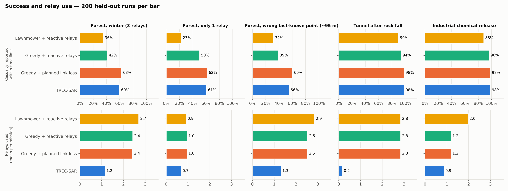
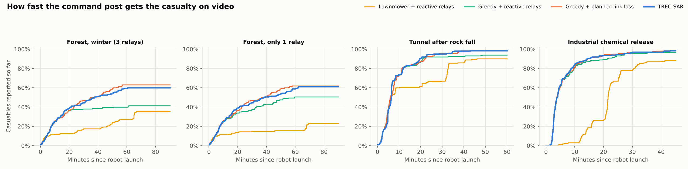

# TREC-SAR — from a fielded tracked UGV to civilian search and rescue

This repository continues **TREC**, a tele-operated tracked ground robot I worked on as a Project Engineer with the
Government of Pakistan (developed at NUST College of E&ME), and rebuilds its ideas for civilian search and
rescue with modern open-source robotics.

## Part 1 — TREC: the original project

**TREC (Tele-operated, Tracked, Reconfigurable UGV)** · Department of Mechatronics, College of Electrical &
Mechanical Engineering, National University of Sciences and Technology (NUST), Pakistan.

| | |
|---|---|
| Platform | Track-wheeled, differential-drive mobile robot; turns about its own centre; high-power drive motors for steep inclines |
| Control | NI cRIO-9012 real-time controller interpreting commands from a laptop control unit; video over IP |
| Specification | 84 × 42 × 20 cm, 80 kg, 8 km/h, two cameras, 30 m night vision |
| Reconfigurable payloads | Manipulator arm with camera, mine-detection payload |
| Operator console | Live video, connection failsafe indicator, continuous battery monitoring with low-battery alarm |

**Milestones**
- Demonstrated to senior government stakeholders.
- Prototype with manipulator handed over for field trials and testing.

*Photos of the original project board are available on request.*

## Part 2 — TREC-SAR: the civilian successor (independent project, 2026)

TREC-SAR is my independent, open-source redesign of TREC for search and rescue in Europe. It is **not** a government
project. All results below are from simulation.

It answers one operational question:

> **Where should the robot search next — and how does it make sure the command post actually sees the casualty when it finds them?**

A detection is worth nothing until a human at the command post receives it. In forests, tunnels and industrial
sites the radio link is the bottleneck. TREC-SAR plans the search **and** the radio network together: where to look,
where to drop relay nodes, and when to accept a planned, time-bounded link loss.

### What changed from TREC

| TREC (original) | TREC-SAR (civilian) |
|---|---|
| Open-loop tele-operation over Wi-Fi | Probability-driven autonomous search, Nav2 + SLAM |
| Link loss shown by a failsafe indicator | Link margin is a first-class planning constraint |
| Reconfigurable payloads (arm, mine detector) | Payload bay carries a thermal mast and a relay-node dropper |
| Single operator, single robot | Drone cue + UGV + command post |
| 84 × 42 × 20 cm, 80 kg, 8 km/h | Same hull, mass and top speed in the simulation model |

### Simulation benchmark



200 held-out simulated missions per policy per scenario (seeds never used for tuning), same casualty location and
detection luck for every policy. Success = casualty reported to the command post within the time limit.

| Scenario | Lawnmower + reactive relays | Greedy + reactive relays | Greedy + planned link loss *(ablation)* | **TREC-SAR** | Relays used (best baseline → TREC-SAR) |
|---|---|---|---|---|---|
| Boreal forest, winter, 3 relays | 36 % | 42 % | 63 % | **60 %** | 2.4 → **1.2** |
| Forest, only 1 relay | 23 % | 50 % | 62 % | **61 %** | 1.0 → **0.7** |
| Forest, wrong last-known point (~95 m) | 32 % | 39 % | 60 % | **56 %** | 2.5 → **1.3** |
| Tunnel after rock fall | 90 % | 94 % | 98 % | **98 %** | 2.8 → **0.2** |
| Industrial chemical release | 88 % | 96 % | 98 % | **98 %** | 1.2 → **0.9** |

Full tables with 95 % confidence intervals: [`results/summary.md`](results/summary.md).

**What the numbers say — honestly:**

1. **Link-awareness is the big win.** Robots that are thrown back by a link-loss failsafe and keep re-trying the
   same out-of-range area waste the mission. Planning the link loss explicitly — search autonomously for a bounded
   time, then come back into coverage to report — lifts forest success from about 40 % to about 60 %.
2. **TREC-SAR matches the best policy's success with far fewer relays** (about half in the forest, about 90 % fewer
   in the tunnel), because it places relays only where the probability map says they pay off.
3. **The price is less live video.** In the tunnel TREC-SAR spends about 5.6 min out of link per mission versus about
   1 min for the relay-hungry ablation. Whether that trade is acceptable is an operator decision, and the weights
   are exposed so it can be tuned.
4. **Where it does not help:** in the open industrial site all probability-driven policies perform the same, and
   with a wrong last-known point TREC-SAR is slightly behind the ablation (confidence intervals overlap).



## What is in the repository

```
core/            trecsar_core: terrain, Bayesian probability map, radio link model, detector model,
                 planners, mission simulator, live-robot mission logic   (pure Python, tested)
scripts/         run_experiments.py (Monte Carlo), make_figures.py
results/         summary.md, results.csv, figures
ros2_ws/src/     trecsar_description  URDF/xacro of the tracked UGV (TREC dimensions)
                 trecsar_gazebo       Gazebo Harmonic worlds generated from the same scenarios
                 trecsar_mission      ROS 2 nodes: mission manager, radio-link simulator, drone stub, detectors
                 trecsar_bringup      one-command launch with SLAM + Nav2 + RViz
perception/      Colab notebook to train a thermal person detector on HIT-UAV; VOC→YOLO converter
docs/            concept, scenarios (CONOPS), research basis, failure modes, running guide
docker/          ROS 2 Jazzy + Gazebo container
```

## Quick start

**2D simulator and experiments (any laptop, about 3 minutes):**

```bash
pip install numpy scipy matplotlib pytest
pytest -q core/tests                          # 29 tests (+1 in ros2_ws)
python3 scripts/run_experiments.py --runs 200 # writes results/
python3 scripts/make_figures.py
```

**3D demo (Ubuntu 24.04 + ROS 2 Jazzy, or the Docker image):** see [`docs/RUNNING.md`](docs/RUNNING.md).

```bash
cd ros2_ws && colcon build --symlink-install && source install/setup.bash
ros2 launch trecsar_bringup bringup.launch.py scenario:=forest_winter planner:=trecsar
```

## How it works (one paragraph)

The probability map starts from a lost-person distance model around the last known point, weighted by terrain
(people follow trails; nobody is inside a lake). Every camera glimpse that finds nothing lowers the probability
where the robot looked (Bayesian search theory); a drone cue raises it near the cue. For each candidate search goal,
TREC-SAR computes expected detection per metre of travel and then checks the radio: is the goal inside coverage? If
not, can a relay dropped at the last well-connected point on the way cover it? If not, can the robot reach it and
return before the link-loss failsafe — or should it commit to an explicitly authorised link-loss window? The best
scoring option wins; the mission state machine handles relay drops, failsafe returns, reporting and battery reserve.
Details: [`docs/CONCEPT.md`](docs/CONCEPT.md).

## Is this new?

Parts of it are well established, and the repository says so: Bayesian search theory (Koopman, Stone; the US Coast
Guard's SAROPS), lost-person behaviour statistics (Koester), and relay "breadcrumbs" dropped by robots in the DARPA
Subterranean Challenge. What TREC-SAR adds is the **combination**: relay placement and link-loss windows chosen from
the *probability of finding the person*, evaluated on time-to-report rather than time-to-detect, packaged as an
open, reproducible benchmark for civilian SAR (forest, tunnel and hazmat). I have not found this exact combination
in open source, but I make no claim that nobody has done it. See [`docs/RESEARCH.md`](docs/RESEARCH.md).

## Limitations

All results are simulation. Radio, detection and lost-person parameters are plausible placeholders, not field
calibration. The 3D stack uses a ground-truth pose shortcut and has not been tested on hardware. Full list:
[`docs/FAILURE_MODES.md`](docs/FAILURE_MODES.md).

## License

Apache-2.0. Datasets keep their own licences.
