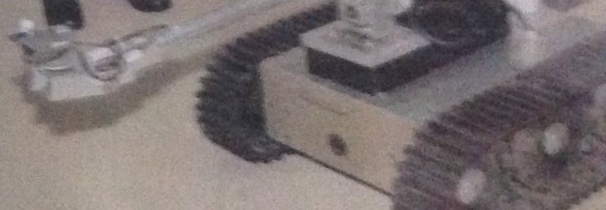
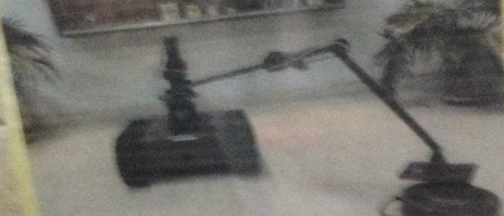

# TREC-SAR — from a fielded army UGV to civilian search and rescue

[](https://github.com/mustafarkhan/trec-sar/actions/workflows/ci.yml)


[](LICENSE)

This repository continues **TREC**, a tele-operated tracked ground robot I worked on as an engineer in the
Pakistan Army's Corps of Electrical & Mechanical Engineers (EME), and rebuilds its ideas for civilian search and
rescue with modern open-source robotics.


**Videos:** [command-line walkthrough (1 min)](media/trec-sar_cli_demo.mp4) · **project walkthrough (2 min):** [`media/trec-sar_github.mp4`](media/trec-sar_github.mp4) — the army project, how the
planner decides, three scenario replays, results, ablation and limits. Every map frame is a recorded simulation run.

## Part 1 — TREC: the original army project

**TREC (Tele-operated, Tracked, Reconfigurable UGV)** · Department of Mechatronics, College of Electrical &
Mechanical Engineering, National University of Sciences and Technology (NUST), Pakistan.

| | |
|---|---|
| Platform | Track-wheeled, differential-drive mobile robot; turns about its own centre; high-power drive motors for steep inclines |
| Control | NI cRIO-9012 real-time controller interpreting commands from a laptop control unit; video over IP |
| Specification | 84 × 42 × 20 cm, 80 kg, 8 km/h, two cameras, 30 m night vision |
| Reconfigurable payloads | Manipulator arm with camera, land-mine detector, weapon mount |
| Operator console | Live video, connection failsafe indicator, continuous battery monitoring with low-battery alarm |

**Milestones**
- Demonstrated to the Commander, 11 Corps (Peshawar).
- Prototype with manipulator delivered to 212 Brigade for field trials and testing.
- Payload live-fire testing at an EME workshop.

<p>
  
  
</p>

## Part 2 — TREC-SAR: the civilian successor (independent project, 2026)

TREC-SAR is my independent, open-source redesign of TREC for search and rescue in Europe. It is **not** an army
project. All results below are from simulation.

It answers one operational question:

> **Where should the robot search next — and how does it make sure the command post actually sees the casualty when it finds them?**

A detection is worth nothing until a human at the command post receives it. In forests, tunnels and industrial
sites the radio link is the bottleneck. TREC-SAR plans the search **and** the radio network together: where to look,
where to drop relay nodes, and when to accept a planned, time-bounded link loss.

### What changed from TREC

| TREC (army) | TREC-SAR (civilian) |
|---|---|
| Open-loop tele-operation over Wi-Fi | Probability-driven autonomous search, Nav2 + SLAM |
| Link loss shown by a failsafe indicator | Link margin is a first-class planning constraint |
| Reconfigurable payloads (arm, mine detector, weapon mount) | Payload bay carries a thermal mast and a relay-node dropper |
| Single operator, single robot | Drone cue + UGV + command post |
| 84 × 42 × 20 cm, 80 kg, 8 km/h | Same hull, mass and top speed in the simulation model |

### Simulation benchmark


200 held-out simulated missions per policy per scenario (seeds never used for tuning), same casualty location and
detection luck for every policy. Success = casualty reported to the command post within the time limit.

| Scenario | Lawnmower + reactive relays | Greedy + reactive relays | Greedy + planned link loss *(ablation)* | **TREC-SAR** | Relays used (best baseline → TREC-SAR) |
|---|---|---|---|---|---|
| Boreal forest, winter, 3 relays | 36 % | 42 % | 63 % | **60 %** | 2.4 → **1.2** |
| Forest, only 1 relay | 23 % | 50 % | 62 % | **61 %** | 1.0 → **0.7** |
| Forest, wrong last-known point (~95 m) | 32 % | 39 % | 60 % | **56 %** | 2.5 → **1.3** |
| Tunnel after rock fall | 90 % | 94 % | 98 % | **98 %** | 2.8 → **0.2** |
| Industrial chemical release | 88 % | 96 % | 98 % | **98 %** | 1.2 → **0.9** |

Full tables with 95 % confidence intervals: [`results/summary.md`](results/summary.md).

**What the numbers say — honestly:**

1. **Link-awareness is the big win.** Robots that are thrown back by a link-loss failsafe and keep re-trying the
   same out-of-range area waste the mission. Planning the link loss explicitly — search autonomously for a bounded
   time, then come back into coverage to report — lifts forest success from about 40 % to about 60 %.
2. **TREC-SAR matches the best policy's success with far fewer relays** (about half in the forest, about 90 % fewer
   in the tunnel), because it places relays only where the probability map says they pay off.
3. **The price is less live video.** In the tunnel TREC-SAR spends about 5.6 min out of link per mission versus about
   1 min for the relay-hungry ablation. Whether that trade is acceptable is an operator decision, and the weights
   are exposed so it can be tuned.
4. **Where it does not help:** in the open industrial site all probability-driven policies perform the same, and
   with a wrong last-known point TREC-SAR is slightly behind the ablation (confidence intervals overlap).


## Quick start

Requires Python 3.10+. Works on Linux, macOS and Windows.

```bash
git clone https://github.com/mustafarkhan/trec-sar.git && cd trec-sar
pip install -e "core[viz]"

trecsar scenarios                                           # list built-in scenarios
trecsar run --scenario forest_winter --seed 1002 --events   # one mission, with its event log
trecsar compare --scenario tunnel --seed 1003 --plot compare.png   # all planners, same mission
trecsar bench --runs 200                                    # the full held-out benchmark (~3 min)
```

Example output:

```
Underground tunnel network — missing worker after rock fall  ·  seed 1003
    lawnmower  NOT REPORTED (FAILED)      relays 4  out-of-link 16.67 min  distance 5775 m  failsafe 17
 greedy_bayes  NOT REPORTED (TIMEOUT)     relays 4  out-of-link 28.63 min  distance 6005 m  failsafe 28
    greedy_sf  REPORTED at 13.25 min      relays 4  out-of-link 1.56 min  distance 1255 m  failsafe 0
      trecsar  REPORTED at 13.2 min       relays 0  out-of-link 8.67 min  distance 1332 m  failsafe 1
```

Every command accepts `--json` for scripting. Python API:

```python
from trecsar_core import World, build, run

world = World(build("hazmat_industrial"))
result = run(world, "trecsar", seed=5, record=True)
print(result.success, result.time_report_s, result.relays_used, result.events[:3])
```

### Model your own site

Paint a map (one pixel = one grid cell, one colour per terrain type), describe it in a few lines of YAML, and
every planner, the benchmark and the plots work on it:

```bash
trecsar compare --site examples/sites/campus/site.yaml --seed 2 --plot campus.png
```

Built-in terrain classes: `open, road, trail, forest, dense_forest, bog, rubble, corridor, water, building, rock,
cliff`; you can add your own with cost, radio loss, canopy and lost-person affinity. See
[`examples/sites/campus/site.yaml`](examples/sites/campus/site.yaml) and [`core/trecsar_core/site.py`](core/trecsar_core/site.py).

### ROS 2

**Headless (no GPU, no Gazebo)** — the full mission stack with a stand-in robot, the same test CI runs on every push:

```bash
cd ros2_ws && colcon build --symlink-install && source install/setup.bash
ros2 launch trecsar_bringup headless.launch.py scenario:=hazmat_industrial seed:=5
ros2 topic echo --once /trecsar/report          # casualty report JSON
```

**3D demo (Gazebo Harmonic + SLAM + Nav2 + RViz)** — Ubuntu 24.04 + ROS 2 Jazzy, or the Docker image; see
[`docs/RUNNING.md`](docs/RUNNING.md):

```bash
ros2 launch trecsar_bringup bringup.launch.py scenario:=forest_winter planner:=trecsar
```

## Engineering quality

| | |
|---|---|
| Tests | 38 unit, behaviour and CLI tests on Python 3.10–3.13, with coverage |
| ROS 2 | All four packages built in CI on ROS 2 Jazzy; end-to-end headless mission must deliver a casualty report |
| Reproducibility | Fixed seeds; tuning seeds (100–159) separate from evaluation seeds (1000–1199); Gazebo worlds regenerated and diffed in CI |
| Code style | `ruff` lint + format, pre-commit hooks |
| Failure analysis | FMEA-style table of failure modes and limitations in [`docs/FAILURE_MODES.md`](docs/FAILURE_MODES.md) |

## What is in the repository

```
core/            trecsar_core: terrain, probability map, radio model, sensor model, planners, mission simulator,
                 live-robot mission logic, custom sites, CLI, benchmark, plotting       (pure Python, tested)
examples/sites/  custom site example (campus park)
scripts/         make_figures.py, make_videos.py (mission replays → MP4), run_experiments.py
results/         summary.md, results.csv, figures
media/           LinkedIn and GitHub videos, README GIF
ros2_ws/src/     trecsar_description  URDF/xacro of the tracked UGV (TREC dimensions)
                 trecsar_gazebo       Gazebo Harmonic worlds generated from the same scenarios
                 trecsar_mission      ROS 2 nodes: mission manager, radio-link simulator, drone stub, detectors,
                                      headless fake robot
                 trecsar_bringup      launch files: 3D (SLAM + Nav2 + RViz) and headless
perception/      Colab notebook to train a thermal person detector on HIT-UAV; VOC→YOLO converter
docs/            concept, scenarios (CONOPS), research basis, failure modes, running guide
docker/          ROS 2 Jazzy + Gazebo container
```

## How it works (one paragraph)

The probability map starts from a lost-person distance model around the last known point, weighted by terrain
(people follow trails; nobody is inside a lake). Every camera glimpse that finds nothing lowers the probability
where the robot looked (Bayesian search theory); a drone cue raises it near the cue. For each candidate search goal,
TREC-SAR computes expected detection per metre of travel and then checks the radio: is the goal inside coverage? If
not, can a relay dropped at the last well-connected point on the way cover it? If not, can the robot reach it and
return before the link-loss failsafe — or should it commit to an explicitly authorised link-loss window? The best
scoring option wins; the mission state machine handles relay drops, failsafe returns, reporting and battery reserve.
Details: [`docs/CONCEPT.md`](docs/CONCEPT.md).

## Is this new?

Parts of it are well established, and the repository says so: Bayesian search theory (Koopman, Stone; the US Coast
Guard's SAROPS), lost-person behaviour statistics (Koester), and relay "breadcrumbs" dropped by robots in the DARPA
Subterranean Challenge. What TREC-SAR adds is the **combination**: relay placement and link-loss windows chosen from
the *probability of finding the person*, evaluated on time-to-report rather than time-to-detect, packaged as an
open, reproducible benchmark for civilian SAR (forest, tunnel and hazmat). I have not found this exact combination
in open source, but I make no claim that nobody has done it. See [`docs/RESEARCH.md`](docs/RESEARCH.md).

## Limitations

All results are simulation. Radio, detection and lost-person parameters are plausible placeholders, not field
calibration. The ROS 2 stack is built and exercised end to end in CI with a headless stand-in robot; the Gazebo +
Nav2 configuration uses a ground-truth pose shortcut and has not been tested on hardware. TREC-SAR is not certified
for operational use. Full list:
[`docs/FAILURE_MODES.md`](docs/FAILURE_MODES.md).

## Contributing and citing

Field data, new sites and planners are welcome — see [`CONTRIBUTING.md`](CONTRIBUTING.md). If you use TREC-SAR in
research, please cite it via [`CITATION.cff`](CITATION.cff) (GitHub shows a "Cite this repository" button).

## License

MIT. Datasets keep their own licences.
