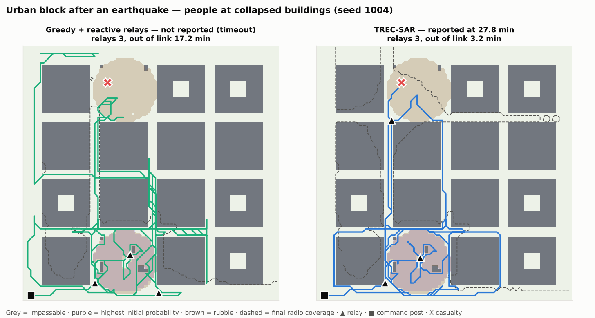
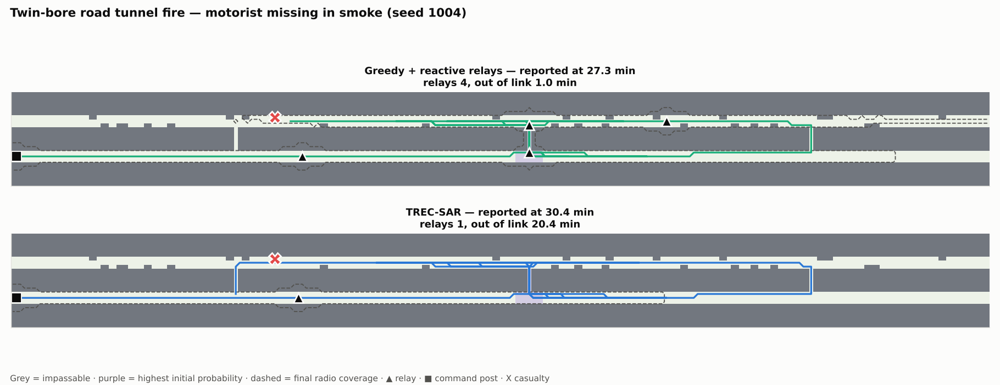

# Scenarios and concept of operations

Each scenario is a story an emergency-service officer would recognise, the timeline the robot follows, and the
things that go wrong. The narratives are fictional; the structure follows common incident-command practice.

---

## 1. Boreal forest, winter night — missing elderly person

**Situation.** 18:40, −12 °C. An 81-year-old with memory loss has walked out of a rural home at dusk. Relatives last
saw him on the forest trail. The rescue service sets up a command post on the road (■ on the maps). Volunteers
will arrive in about an hour; hypothermia risk is high.

**Assets.** One drone with a thermal camera. One TREC-SAR UGV with a thermal/RGB mast, a thermal blanket and two-way
audio in the payload bay, and three relay nodes.

| Time | What happens |
|---|---|
| T+0 | UGV leaves the command post. Probability map built from the last known point and the trail network. |
| T+4 min | Drone sends a cue: something warm near the bog edge. Under dense spruce the drone often sees nothing. |
| T+5–20 min | UGV searches trail-side forest inside radio coverage first; first relay goes down where the trail enters the forest only if the map says the area beyond is worth it. |
| — | Beyond the granite ridge, radio stops. TREC-SAR authorises a bounded search window instead of spending its last relay. |
| T+x | Person detected. UGV stops, plays a voice message, drops the blanket (future payload), drives back into coverage and pushes video + position to the command post. |

**What goes wrong:** a frozen lake that looks like open ground (TREC-SAR treats ice as no-go by policy); battery
capacity loss in the cold (25 % derate in the model); drone false alarms (15 % rate in the model).

---

## 2. Tunnel network after a rock fall — missing worker

**Situation.** A maintenance worker's last radio check-in came from the north-east work face shortly before a rock
fall. The roof is unassessed: nobody goes in. There is no GPS and radio dies at the first bend.

**Assets.** TREC-SAR UGV with four relay nodes. No drone.

| Time | What happens |
|---|---|
| T+0 | UGV enters through the portal. Probability concentrated around the work face but spread along all drifts (people flee a rock fall in any direction). |
| T+2–6 min | At each junction the planner decides: drop a relay here, or run a short planned link-loss window into a dead-end drift and come back. |
| — | The rubble zone is slow but passable; the robot crosses it, a person would not. |
| T+x | Detection → back to the last junction with coverage → report. |

**What goes wrong:** relays used up early on the main adit (the reactive "drop when signal drops" habit does this);
dust blinding the camera (not modelled); collapsed side drifts (not modelled).

---

## 3. Industrial chemical release — casualty in the hot zone

**Situation.** A valve fails and releases ammonia. One worker near the leak does not answer the radio. Firefighters
hold the cordon upwind; entering the plume needs full chemical protection and time.

**Assets.** Drone over the open yard, TREC-SAR UGV with two relays.

| Time | What happens |
|---|---|
| T+0 | UGV leaves the cordon. Probability concentrated around the leak and downwind. |
| T+1.5 min | Drone cue from the open yard; between tanks the drone sees little. |
| T+3–8 min | UGV searches between tanks and pipe racks; steel shadows the link, so goals behind structures are checked against coverage. |
| T+x | Report pushed; firefighters enter with a known location instead of searching in protective suits. |

**What goes wrong:** gas sensor mapping is not modelled (future payload); wind shifts moving the plume (not
modelled); robot decontamination after the mission is a real operational cost.

---

## 4. Urban block after an earthquake — people at collapsed buildings

**Situation.** A shallow earthquake has brought down two or three apartment buildings in a dense block, the kind
of event southern and south-eastern Europe plans for. Residents were last heard at the largest collapse.
Aftershocks continue; urban search and rescue teams (working to INSARAG guidelines) stay off the rubble until a
structural engineer clears each pile.

**Assets.** Drone over the block, TREC-SAR UGV with three relays, assembly area at the edge of the district.

| Time | What happens |
|---|---|
| T+0 | UGV leaves the assembly area. Probability concentrated on the rubble piles, highest at the last-heard point. |
| T+2 min | Drone cue. Dust and broken slabs hide people from above about half the time. |
| T+2–10 min | UGV works the rubble surface and the streets around it. Standing buildings and reinforced concrete shadow the radio, so each pile needs a relay or a planned link-loss window. |
| T+x | Detection → report; the team goes to one pile instead of probing three. |

**What goes wrong:** an 80 kg tracked robot searches the surface and the fringe of a pile, not the voids inside
it (not modelled); aftershocks shifting the rubble (not modelled); dust on the cameras (not modelled).

---

## 5. Twin-bore road tunnel fire — motorist missing in smoke

**Situation.** A lorry burns deep inside a one-kilometre twin-bore road tunnel. Most motorists walked out
through the cross-passages into the second bore; one is unaccounted for. Smoke fills the incident bore and the fire
service will not send crews past it yet.

European road tunnels are built to common minimum rules (Directive 2004/54/EC for tunnels over 500 m on the
trans-European network): emergency exits at most 500 m apart, emergency stations every 150 m in new tunnels.
The scenario follows that layout: two bores, cross-passages every 250–330 m, stopped vehicles in the incident bore.

**Assets.** TREC-SAR UGV with four relays, entering through the second bore. No drone.

| Time | What happens |
|---|---|
| T+0 | UGV enters the second bore. Probability highest at the cross-passages (people in smoke head for the exits) and in the smoke near the fire. |
| T+3 min | About 400 m in, the 2.4 GHz link from the portal runs out. The planner decides where the first relay pays off. |
| T+4–12 min | The UGV checks each cross-passage and the smoke-filled stretch between stopped vehicles. |
| T+x | Detection → back into coverage, or a relay chain, to report. |

**What goes wrong:** heat near the fire (not modelled; the robot is assumed to stay outside the lethal zone);
smoke degrades the thermal camera (modelled as 60 % occlusion); the tunnel's own emergency radio re-broadcast
system, which the Directive requires in tunnels over 1 000 m with enough traffic, is not used.

---

## Variants used in the experiments

- **Two-link radio.** Forest, mine tunnel and urban block with an added 868 MHz telemetry and report link at
  European power and duty-cycle limits; see [`EU_RADIO.md`](EU_RADIO.md).

- **Forest, only one relay.** Tests graceful degradation when hardware is scarce.
- **Forest, wrong last-known point.** The person is sampled around a point about 95 m from where the planner thinks
  the LKP is. Tests robustness to bad witness information.
